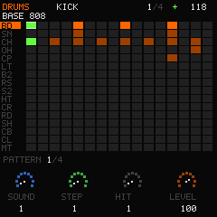
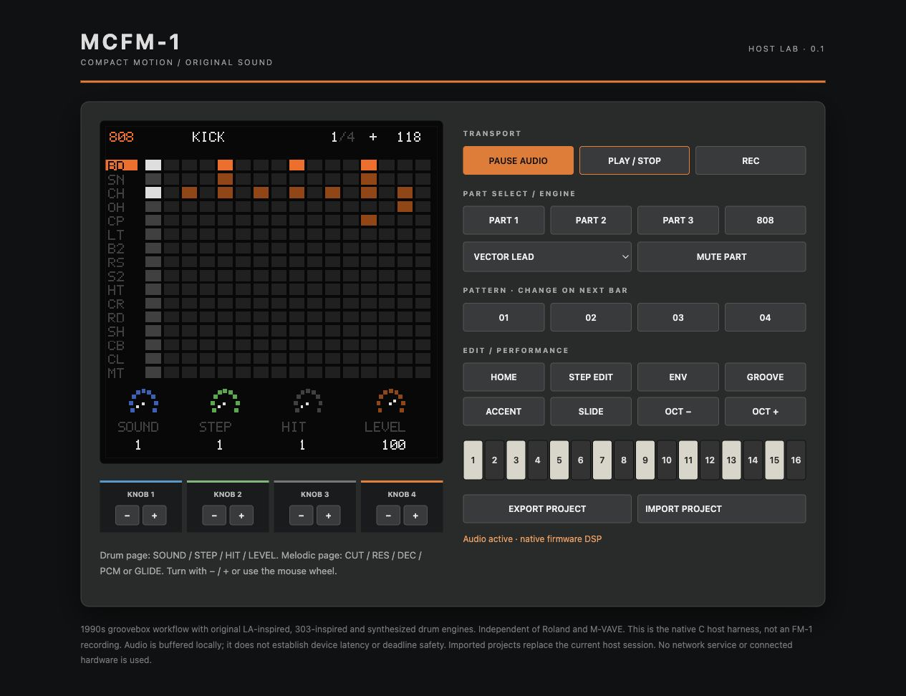

# MCFM-1

**An original 1990s-style groovebox for the M-VAVE FM-1.**

Three melodic parts, each choosing an **LA-inspired** or **303-inspired** engine, plus a **16-lane synthesized drum part**. Four patterns, live playing, step editing, recording, accent, slide, part mute, queued pattern changes and hands-on controls.

The compact dark panel, orange accents and drum grid take inspiration from the Roland MC-series workflow. MCFM-1 is **not a Roland emulation**, is not affiliated with Roland or M-VAVE, and does not use Roland ROMs, samples, patches, logos or compatibility formats.

> **Experimental 0.1:** the native host engine, sequencer, display and storage tests work. The pi32v2 target build and Linux/macOS host checks pass; see the [validation record](docs/VALIDATION.md). No FM-1 boot, listening, stability, control calibration or audio-deadline test has been performed. An experimental `.fwsc` package build is available; installation on hardware remains unverified. The compiled raw target app is not an installer. See [package boundaries](BUILDING.md#experimental-fwsc-package).





## Try it on your computer

Requires a C11 compiler, Make and Python 3. No Python packages, SDK or audio plugins are required.

```sh
make test
make render                    # build/demo.wav, actual sequencer and DSP
python3 host/serve.py           # http://127.0.0.1:8091
```

Click **ENABLE AUDIO**, then **PLAY / STOP**. Choose **808** for the drum grid. Turn the four knobs using − / + or the wheel. Export/import `.mcf` projects with the host panel; these files include a version and CRC. Audio is locally buffered by the browser, so preview latency is not device latency. Pause audio before closing the panel. The server binds loopback only and has no hardware access.

The command-line harness also works without a browser:

```sh
make
build/mcfm-host render build/demo.wav 16
build/mcfm-host preset 3 build/glass-bell.wav
build/mcfm-host screen build/drums.ppm 3
build/mcfm-host                 # interactive command help
```

[Listen to NIGHT CIRCUIT](docs/audio/night-circuit.wav): an original host-rendered four-pattern demo at 118 BPM. It is not a recording of an FM-1 or Roland device.

## Listening demos

- [NEON SPIRAL — 56-second original psy-trance study](docs/audio/neon-spiral.wav)
- [LA lead, pad and bell](docs/audio/la-showcase.wav)
- [303 cutoff and slide](docs/audio/303-showcase.wav)
- [808 synthesized drums](docs/audio/808-showcase.wav)
- [Full factory mix](docs/audio/full-mix-preview.wav)

The MC-505 factory demo video's opening chapter is labeled
[Psy Trance](https://www.youtube.com/watch?v=d9VYCMy6IOc). NEON SPIRAL explores that
broad style using an original 140 BPM composition: rolling bass, acid sequence,
LA arpeggio, drum dropout and return, with cutoff and resonance sweeps.
It does not recreate or claim a listening match to the original demo.
At 27.4–34.3 seconds the isolated acid line sweeps cutoff and resonance; at 34.3
seconds drums/bass return, and at 41.1 seconds the LA arpeggio joins.
The host performs mutes/pattern changes/knobs through the shared C core; automatic
song arrangement is not a firmware feature. All five listening files use only
peak gain to −3.01 dBFS, without external instruments or effects. They are not
device recordings or relative-loudness comparisons. Rebuild with
`python3 tools/showcase.py`; [metrics and hashes](docs/showcase-report.json).

## What is implemented

| Area | Implementation |
|---|---|
| LA-inspired sound | Six original 512-sample PCM attacks, dual detuned band-limited sustain oscillators, envelope and filter |
| 303-inspired sound | Per-part mono saw/square, resonant four-stage filter, accent and continuous pitch slide |
| Drums | 16 synthesized sounds: kicks, snares, hats, clap, toms, rim, crash, ride, shaker, cowbell and claves |
| Factory bank | 12 original presets spanning leads, bass, pad, bells, pluck and digital textures |
| Sequencer | Four 16-step patterns, three-note melodic steps, 16 drum lanes, 40–240 BPM, swing, gate, accent and slide |
| Performance | Part mute, queued bar-boundary pattern changes, live keyboard, quantized recording and step entry |
| Screen | Shared C RGB565 renderer; 240×240 display with a 240×8 strip buffer on device |
| Persistence | Versioned 2,132-byte record, CRC and A/B commit-last storage; explicit save only |
| Hardware source | Inherited GPL FM-1 startup/HAL, I2S DMA, keypad/encoders, LCD, master ADC, watchdog and guarded flash |

**Resource limits are deliberate:** eight shared melodic voices, with oldest-voice stealing, and six shared drum voices for 16 sounds. Every part can use either melodic engine; each 303 part is monophonic. These are allocator limits, **not verified real-device polyphony**. No sample streaming, SD support, flash expansion, USB audio/MIDI, external MIDI sync, effects, song arranger or original-patch compatibility is promised in this version.

## FM-1 panel mapping

| Control | Action |
|---|---|
| SELECT / SEL | Select part 1–3 or drums |
| ALGORITHM | Browse melodic presets (both engines); on drums, queue pattern |
| PRESETS | Queue pattern 1–4; switches at the next bar while playing |
| PLAY / REC | Start or stop / toggle quantized recording |
| ARP | Mute selected part |
| SEQ or EDIT | Toggle step-entry mode; melodic knobs become STEP / VEL / GATE / A-S |
| HOME | Return to performance controls |
| ENV | Attack / decay / sustain / release for melodic parts |
| GLO | Tempo / swing / pattern / selected part level |
| LFO / FX | Toggle accent / slide on the selected melodic step |
| OCT− / OCT+ | Keyboard octave; hold both five seconds while stopped to enter UBOOT |
| SAVE twice, stopped | Explicitly save project to the A/B project sectors |

On the **drum screen**, the knobs always address **SOUND / STEP / HIT / LEVEL** except on GLO. HIT clockwise sets the selected hit, counterclockwise removes it. LEVEL changes that sound's kit level. Playing keys select/audition the 16 sounds; in step-entry or recording mode they toggle hits. Melodic step entry writes one note; factory chords remain playable but chord entry is not yet exposed by the panel. Record is quantized to the current step, with fixed default velocity and gate.

**Storage warning:** the first confirmed device save uses `0x97000` and `0x98000`, which are the previous firmware's project slot 0 sectors. Back up that project before using MCFM-1 save. Boot never formats flash, there is no autosave, and the flash driver is restricted to those two sectors. Existing calibration/global settings, samples and bootloader regions are not written. The stock/default panel mapping is used; calibration import is not implemented.

## Build and verification

See [BUILDING.md](BUILDING.md), [architecture and memory boundaries](docs/ARCHITECTURE.md), [validation record](docs/VALIDATION.md) and [licensing/provenance](NOTICE.md).

Code and original generated assets: **GPL-3.0-only**. Hardware support is derived from [dspaudio/orbit](https://github.com/dspaudio/orbit), tracing to SLOOP/Felucca by Leo Kuroshita and Hügelton Instruments. Restricted upstream artwork and sample packs are excluded.
