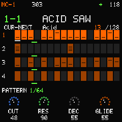
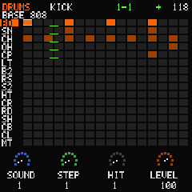
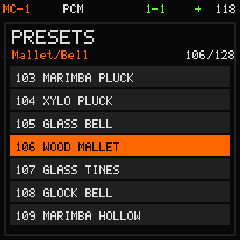
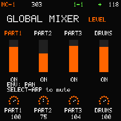
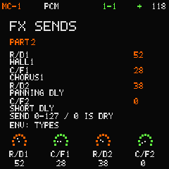
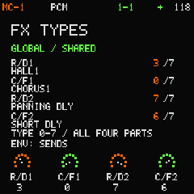
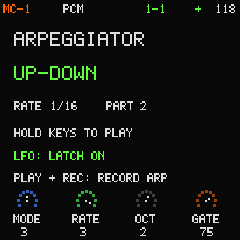
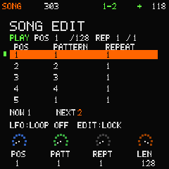
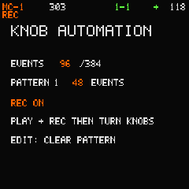
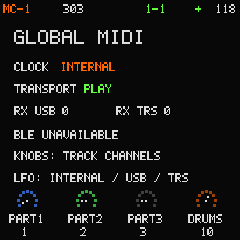

# MC-1 1.2.0 - rebuilt LA-PCM engine and sound bank

**A rebuilt LA-PCM engine. All 112 LA sounds replaced.**

MC-1 is an original four-part groovebox for the M-VAVE FM-1. This release
replaces both the LA sound-generation path and its instrument data, rather than
adding a few presets. Real recorded attacks restore piano, guitar and orchestral
identity; phase-coherent synthesized sustain removes the old detuned beating.

**Dual-core firmware for the FM-1:** CPU0 handles sequencing, controls and five
melodic DSP voices; CPU1 handles three melodic voices, six drums and four shared
FX banks. Version 1.2.0 replaces all 112 LA sounds with a source-backed
**LA-PCM engine: real recorded attacks plus phase-coherent synthesized sustain**.
It corrects sustain beating, restores instrument-specific attacks and separates
ROOM/HALL reverb character, within the previous PCM budget. The 16 Acid sounds,
synthesized drums and eight melodic voices are retained. The installer also
offers the unchanged **1.0.2 single-core** release. See [release notes](docs/RELEASE_1.2.0.md),
[four-bank design](docs/FOUR_BANKS.md) and [device validation](docs/VALIDATION.md).

Version 1.2.0 retains readable white 6x9 small text and flowing green playback
underlines only below populated tracks/drum rows. All twelve menu buttons and both OCT buttons are lit;
selected menus blink at 2 Hz, and running PLAY blinks green at the sequencer BPM.
HOME remains steadily lit during playback.
These controls replace 1.0.2's steady PLAY indication.

Build a pattern, play a chord and shape it with the panel. MC-1 combines three
melodic parts with a sixteen-lane drum part, 128 melodic presets, eight drum
kits, song arrangement, arpeggiation and recorded knob movement. Its sound,
sequencer, display and project format come from the same C core on the device,
native host and browser emulator.

## Hear the rebuilt LA-PCM engine

- [Hip-hop piano](docs/audio/mc-1-hip-hop-piano.mp3): an original swung piano melody and chords.
- [Pop nylon guitar](docs/audio/mc-1-pop-guitar.mp3): an original picked/strummed hook.
- [Chamber strings](docs/audio/mc-1-chamber-strings.mp3): cello, viola and violin ensemble.

These are current shared-C engine renders, not FM-1 recordings. The
[product page](https://dspaudio.github.io/mc-1/#listen) includes native players,
downloads and the two updated full-groove demos. Sources and licenses are
documented in [NOTICE.md](NOTICE.md); export settings and hashes are in
[the audio manifest](docs/release-audio.json).

[Explore MC-1](https://dspaudio.github.io/mc-1/) ·
[Install firmware on an FM-1](https://dspaudio.github.io/mc-1/install.html) ·
[Play the web emulator](https://dspaudio.github.io/mc-1-web/)

MC-1 takes workflow inspiration from 1990s grooveboxes. It is not a Roland
emulation and is not affiliated with Roland or M-VAVE. No Roland ROMs, samples,
patches, logos or compatibility formats are included.

## See the instrument

These are fresh renders of the actual shared C display, not interface mockups
or photographs of hardware. Orange marks selection; green follows playback.

<p>


</p>

**Pattern and drums.** Follow all four parts from HOME, then edit individual
hits and lane levels in the sixteen-lane drum grid.

<p>


</p>

**Sounds and balance.** PRESETS browses the sound bank or drum kits; GLOBAL
MIXER keeps all four part levels together.

<p>


</p>

**Shared effects.** Each part sends independently to R/D1, C/F1, R/D2 and C/F2.
ENV switches between the selected part's four sends and the four global FX types.

<p>


</p>

**Performance and arrangement.** Turn held chords into phrases, record them,
and arrange patterns into a song.

<p>


</p>

**Movement and connections.** Keep knob automation with the project and route
notes, controllers and clock through the supported MIDI connections.

## What is included

| Area | MC-1 1.2.0 |
|---|---|
| Melodic sound | Source-backed LA hybrid PCM with real attacks and two same-phase spectral sustain frames, or a monophonic 303-inspired saw/square engine with accent and slide |
| Presets | 112 source-backed LA patches from 17 CC0 instrument families and 16 original Acid patches, in 14 categories |
| Drums | Eight synthesized kits, each with 16 common lane roles |
| Patterns | 64 patterns, 16 steps and four parts; three-note melodic steps; 40-240 BPM, swing, gate, accent and slide |
| Songs | Up to 128 ordered pattern/repeat entries, 1-16 repeats each, with end stop or looping |
| Performance | Live playing, queued pattern changes, part mute, six ARP modes, note recording and 384 step-quantized automation events |
| Effects | Four global eight-type banks (R/D1, C/F1, R/D2, C/F2), four sends per part, melodic Analog variance; master volume and stereo-linked limiter |
| Connections | USB MIDI input/output, TRS MIDI input and stereo USB Audio output at 44.1 kHz/16-bit |
| Display | Shared 240x240 RGB565 renderer; device rendering uses a 240x8 strip buffer |
| Storage | Version 8 projects, imports versions 1–7, CRC and commit-last A/B storage in two 36 KiB banks; explicit SAVE only |

Eight melodic voices are shared across the three melodic parts, with oldest-voice
stealing. Six drum voices are shared across the sixteen lanes. Each Acid part
is monophonic. The two R/D banks each choose one of eight delay/reverb types;
the two C/F banks each choose one of eight chorus/flanger types.

No sample streaming, SD support, flash expansion, onboard BLE MIDI, TRS MIDI
output, computer-to-device USB audio or USB host mode is implemented. The
browser can use BLE MIDI ports already exposed by its operating system; this
does not enable the FM-1's radio. See [MIDI and connection limits](docs/MIDI.md).

## Install on an FM-1

The [firmware web installer](https://dspaudio.github.io/mc-1/install.html) belongs
to this repository's GitHub Pages site. **mc-1-web is only the emulator.**

1. Connect the FM-1 directly by USB and stop playback. Close other MIDI applications.
2. Open the installer in a secure browser with Web MIDI SysEx support, such as
   desktop Chrome or Edge. Choose **Connect FM-1** to discover the instrument
   automatically and read its identity; no MIDI port selection is needed.
3. Choose **1.2.0 dual-core** or **1.0.2 single-core**, check the verified package,
   then choose **Install firmware**.
   Keep the page, USB and power connected until restart verification finishes.

The page verifies the pinned package's SHA256, CRCs, product identity and update
loader before installation. It handles the loader and application stages and
checks the restarted protocol identity. `FM-1_900` identifies the update protocol,
not the MC-1 version. If interrupted during writing, reconnect the update-loader
ports and retry the same package. The release also provides a desktop installer
path for browsers without Web MIDI SysEx.

A raw `.app.bin` is not an installer. Updating does not reformat MC-1's project
banks, but it is not a backup or a saved-data verification protocol. Electrical
power-loss recovery remains unverified. See [the package boundary](BUILDING.md#experimental-fwsc-package).

**Downgrading is not project conversion:** 1.2.0 saves format 8; 1.0.2 cannot
load those saves. The firmware switch retains the project banks, but saving
after a downgrade can overwrite earlier projects. Keep a compatible backup
where available and do not assume the older firmware will open a newer save.
Even though 1.1.0 also uses format 8, it rejects projects containing 1.2.0's new
nylon-guitar PCM source (ID 40).

### Runtime faults and rebooting

A CPU1 job timeout or invalid result disables the worker and recomputes its work
on CPU0; heavy loads can then miss audio deadlines. CPU1 is not automatically
restarted. A fatal system exception stops audio and attempts UBOOT entry after
holding CPU1; if that hold cannot be confirmed, it stops audio without forcing
the transition. Power cycling runs the same installed app, not an automatic
rollback. A recurring startup fault can therefore return to UBOOT again.

`WL80UBOOT1.00` is the ROM USB mode, not the MIDI update loader. The web installer
cannot recover that mode. It needs a separate, device-verified recovery procedure;
do not try a generic whole-flash/factory erase. See the installer recovery
guidance and [the measured recovery record](docs/FOUR_BANK_HARDWARE_2026-10-19.md).

### Restore official V15

The same [installer](https://dspaudio.github.io/mc-1/install.html#restore-title)
can return a working MC-1 to M-VAVE's official V15 firmware, including existing
1.0.1 installations. No intermediate firmware update is required.

1. Download and keep M-VAVE's original V15 `FM-1.fwsc` from
   [M-VAVE downloads](https://www.m-vave.com/download). Do not select V14 or a
   renamed custom firmware.
2. Open **Restore official V15**, select that file, and wait for verification.
   The page checks its exact SHA256, byte size and package layout locally;
   it does not upload or redistribute M-VAVE's firmware.
3. Connect the FM-1, read the data-compatibility notice and acknowledge it,
   then choose **Restore official V15**. Keep the page, power and USB connected.
4. Wait for restart verification as `FM-1_015`. If writing is interrupted,
   reopen the page, select the same official file and retry from the update loader.

MC-1 projects and patches are not usable in V15. This is firmware restoration,
not a backup, project conversion or factory reset; saved-data retention is not
guaranteed. The separate factory USR patch bank is not rewritten. The browser
preserves the official application image and pairs it
with MC-1's verified RAM update loader, so the flash head is never rewritten
and the recovery-record sector stays separate from the loader.

## Version 1.0.2 changes

The installer adds verified official V15 restoration, progress, restart identity
checks and retry guidance. The existing small RAM loader is reused rather than
relaxing firmware staging limits or flash-write boundaries. The device firmware
package is byte-identical to the pinned 1.0.1 diagnostic package; this release
changes the installer and release metadata, not the audio engine or project format.

## Version 1.0.1 changes

Shared reverb returns are stronger, with longer HALL and PLATE tails using the
existing buffers and processing stages. PLAY uses its separate green LED during
playback, including PLAY + REC; the REC indicator remains independent. The lower
queued-pattern duplicate is removed while the upper destination stays visible.
Flash, RAM and CPU acceptance budgets are documented in
[Architecture and budgets](docs/ARCHITECTURE.md).

Project format 7, eight melodic voices, six drum voices and both eight-type FX
banks are retained. Existing sends are preserved; a zero send still sounds dry.
New projects start with ROOM2 reverb sends of 12 / 72 / 24 / 8, giving PART2
more ambience while the other parts stay subtle. Both built-in demos enable
shared reverb and chorus, with PART2's reverb send at 112. The Pages MP3 is
rendered from the same FX-enabled NEON SPIRAL demo.
Candidate-specific checks and hardware limits are recorded in
[VALIDATION.md](docs/VALIDATION.md).

## Measured 1.0.0 device performance

The accepted 1.0.0 package keeps **eight melodic voices plus six drums and both full
shared FX banks**, including actual USB Audio cold PLAY and STOP/PLAY tests.

| Workload | Measured maximum | Limit |
|---|---|---|
| FX-only PLATE + FLANGER, frozen-valid repeats | 17,621 TIMER4 ticks | Approximately 21,900 ticks |
| Eight LA voices + six drums + PLATE/FLANGER with real USB Audio | 66,718 TIMER4 ticks | 69,648 ticks per 128-frame block |

All 21 final captures record zero deadline misses and zero DMA-half changes.
All six USB captures contain real nonzero stereo PCM and zero USB underruns.
Ten master-ADC-changing records remain excluded from formal paired performance
comparisons; they have not been relabeled as frozen-valid measurements.

Exact fixed-point division and bounded voice preparation reduce cost without
removing voices, effects or processing rate. Native differential checks match
PCM, MIDI and all 77,168 engine-state bytes over 17,614,272 frames. Host execution
time is not evidence of device timing. The tested hash, workloads, exclusions,
raw evidence and remaining limits are in [VALIDATION.md](docs/VALIDATION.md).

## Try it without hardware

The [web emulator](https://dspaudio.github.io/mc-1-web/) runs the shared C engine
in an AudioWorklet with its own IndexedDB project storage. It does not install
firmware or emulate the FM-1 CPU, USB Audio device or hardware timing.

For the native host, use a C11 compiler, Make and Python 3. Checked-in PCM tables
make ordinary builds independent of the SDK, plugins and Python packages.

```sh
make test
make render                    # Actual sequencer and DSP -> build/demo.wav
python3 host/serve.py           # http://127.0.0.1:8091
```

Choose ENABLE AUDIO and PLAY / STOP, then use the panel, mouse wheel or minus/plus
controls. The host panel can export/import versioned, CRC-protected `.mcf`
projects. It binds loopback only and has no hardware access. Browser buffering
means preview latency is not device latency; pause audio before closing it.

```sh
make
build/mc1-host render build/demo.wav 16
build/mc1-host preset 104 build/glass-bell.wav
build/mc1-host screen build/drums.ppm 3
build/mc1-host                 # Interactive command help
```

## Panel and pattern workflow

| Control | Action |
|---|---|
| SELECT / SEL | Select melodic part 1-3 or drums |
| ALGORITHM | Select pattern 1-64; queue a bar-boundary change while playing |
| PRESETS | Browse melodic presets or drum kits; the popup closes after 500 ms idle |
| PLAY / REC | Start/stop transport; toggle quantized recording |
| HOME | Return to performance controls |
| ENV | Edit the melodic envelope; in FX, switch SENDS / TYPES; in MIXER, switch LEVEL / PAN |
| FX | Open the selected part's FX sends and global type choices |
| ARP | Open/close the melodic arpeggiator; in GLOBAL MIXER, mute the selected part |
| LFO | Accent, or LATCH on the ARP page; LOOP in SONG |
| SEQ / EDIT | Switch PATTERN / SONG; toggle step entry or song editing |
| GLO | Cycle GLOBAL MIXER, GROOVE, DEMO LIBRARY, KNOB AUTOMATION, MIDI and ANALOG |
| OCT- / OCT+ | Change keyboard octave; hold both five seconds while stopped for UBOOT |
| SAVE twice while stopped | Explicitly save the project to the A/B banks |

Slow encoder turns move one step; rapid same-direction turns accelerate larger
ranges. Small choices such as parts and kits remain precise. To jump across all
64 patterns, hold OCT- and use the first four black keys to select a bank
(1-16, 17-32, 33-48 or 49-64), then choose a pattern with the white keys. These
chords do not play or record notes. A normal OCT- tap lowers the octave on release.
Leave SONG with SEQ before using this pattern shortcut.

HOME shows note-pitch marks for up to three notes per melodic step, using a
consistent range across the part's patterns. PATTERN identifies the playing
pattern; NEXT identifies a queued change. Save/load messages take priority.
On drums, the knobs select SOUND / STEP / HIT / LEVEL. HIT adds or removes the
selected hit; LEVEL changes that sound's kit level. Keys audition/select lanes
and toggle hits during step entry or recording. Melodic panel step entry writes
one note; factory chords remain playable but chord step entry is not exposed.
Recording uses fixed default velocity and gate, quantized to the current step.

Press GLO once for GLOBAL MIXER: its four knobs always control PART1 / PART2 /
PART3 / DRUMS, regardless of selection. ENV switches LEVEL / PAN; PAN shows
left/center/right positions (0 / 64 / 127). ARP mutes the selected part in either
view. Muted controls are dimmed and labeled MUTE. Levels and pans are saved
with the project, and PLAY + REC records their knob changes as automation.

For Acid sounds, overlap keys for legato glide. HOME's GLIDE knob controls speed;
zero disables live glide. Releasing the active key returns to the highest remaining
held key. Overlapping recorded destinations receive SLIDE. PLAY blinks green
at the sequencer BPM; HOME stays lit during playback. Held-key LEDs coexist
with the playback cursor.

## Song arrangement

Press SEQ, then EDIT. The four knobs control POS / PATT / REPT / LEN. Set a length
above zero, choose patterns and repeats for the entries, then press PLAY. LFO
switches whole-song looping; without it, playback stops after the final entry.
SEQ returns to pattern mode and stops transport. Song entries reference patterns,
so a pattern edit is heard at every position that uses it. HOME -> ENV still
provides ATK / DEC / SUS / REL for melodic sounds.

## Shared FX

Each part has four independent 0-127 sends: **R/D1**, **C/F1**, **R/D2** and
**C/F2**. From HOME press FX. SENDS edits the selected part; ENV switches
to TYPES, which selects the four banks globally. Knobs 1-4 follow that order.
Zero send is dry. Pressing FX again does not open a
master-effects page.

| Type | R/D bank | C/F bank |
|---|---|---|
| 0 | ROOM1 | CHORUS1 |
| 1 | ROOM2 | CHORUS2 |
| 2 | ROOM3 | CHORUS3 |
| 3 | HALL1 | CHORUS4 |
| 4 | HALL2 | FB CHORUS |
| 5 | PLATE | FLANGER |
| 6 | DELAY | SHORT DLY |
| 7 | PANNING DLY | FB SHORT DLY |

All four banks return wet signal; dry parts are mixed separately. Changing a type
resets only that bank. These are original compact fixed-point effects, not
emulations of Roland algorithms or specific hardware. After the sum, the master
stage contains only volume and the linked limiter.

Press GLO six times from HOME for ANALOG. Knob 1 sets the selected melodic
part's variance from 0-127: zero retains the original sound; larger values add
bounded voice tuning variation and slow drift. Drums are excluded. PLAY + REC
records amount changes as automation.

## Arpeggiator and knob recording

ARP opens the selected melodic part's MODE / RATE / OCT / GATE controls. Its six
active modes are UP, DOWN, UP-DOWN, ORDER, RANDOM and CHORD; OFF restores ordinary
playing. Rates are quarter/eighth/sixteenth notes, octave range 1-3 and gate 1-100%.
LFO toggles latch. Changing mode or latch releases the ARP notes; play again to
restart the phrase. Up to 32 held notes are tracked, and CHORD uses up to three
notes per step within the eight-voice and monophonic-Acid limits. Drums display
an explanation instead; ARP retains the mute function in GLOBAL MIXER.

PLAY + REC writes generated ARP notes, with continuation steps for long gates.
Turn REC off and release the keys to audition the recorded phrase. Sound,
envelope, part levels, drum-lane levels and FX send/type movements are recorded
at the current sixteenth-note step. Changes to the same parameter on the same
step replace its value. Note edits, tempo/swing and ARP setup are not knob automation.

GLO four times opens KNOB AUTOMATION, showing the shared 384-event capacity,
current-pattern usage and REC state. EDIT clears only the current pattern's
automation. At capacity, existing events can be overwritten, but unrelated data
is not replaced. Explicit SAVE retains the performance in the version 7 project.
Edited sounds retain their source preset name with `*`; custom imported sounds
without a known source display IMPORTED SOUND.

## Projects and compatibility

Version 7 imports project versions 1-6 and migrates their FX to shared sends and
types. R/D takes each part's larger legacy delay/reverb amount; C/F takes its
modulation amount. The dominant delay/reverb source selects the mapped R/D type;
the first modulation source selects C/F. Amount automation migrates to sends,
and the chosen source part's type automation migrates to the global types.
Legacy drive, filter and master-FX fields remain inactive compatibility data.
Projects using newer recorded PCM IDs cannot load in firmware that does not know
them. Earlier development flash layouts are not automatically migrated.

Device projects occupy two dedicated 36 KiB banks at `0x99000..0xAAFFF`.
SAVE can overwrite data another firmware left there. Boot never formats flash,
and there is no autosave. Earlier MC-1 sectors `0x97000..0x98FFF`, calibration,
global settings, sample regions and bootloader remain outside the application
write allowlist. Calibration import is not implemented.

## Built-in demos and listening

While stopped, press GLO three times, choose NEON SPIRAL with knob 1, turn LOAD
(knob 4) clockwise, then PLAY. Loading replaces the current RAM project; export
work first. Flash changes only after explicit SAVE. NIGHT CIRCUIT restores the
original pattern bank. Reloading a demo restores its original mix.

NEON SPIRAL is an original 140 BPM, 32-bar psy-trance performance with rolling
bass, acid, recorded marimba, mutes, pattern changes and filter movement. It stops
with FX tails. Its broad style reference is the opening Psy Trance chapter of
the [MC-505 demo video](https://www.youtube.com/watch?v=d9VYCMy6IOc), not a recreation
or listening-match claim.

- [NIGHT CIRCUIT with FX, 320 kbps MP3](docs/audio/mc-1-night-circuit-fx.mp3)
- [NEON SPIRAL with FX, 320 kbps MP3](docs/audio/mc-1-neon-spiral-fx.mp3)
- [NEON SPIRAL WAV](docs/audio/neon-spiral.wav)
- [LA lead, pad and bell](docs/audio/la-showcase.wav)
- [303 cutoff and slide](docs/audio/303-showcase.wav)
- [Synthesized drums](docs/audio/808-showcase.wav)
- [Eight kits, 64-second comparison](docs/audio/kit-showcase.wav)
- [NIGHT CIRCUIT factory mix](docs/audio/full-mix-preview.wav)
- [Sixteen recordings, 48-second comparison](docs/audio/recorded-showcase.wav)

Listening files are host renders, not device recordings or relative-loudness
comparisons. WAV examples use peak-only gain to -3.01 dBFS with no external
instruments or effects. The kit comparison follows the kit table, eight seconds
each: four seconds of individual lanes, three seconds of groove and one of tail.
The recording comparison uses note 60 for three seconds per source in manifest
order. These compact mono excerpts and sustain loops are not full multisamples.
Rebuild with `python3 tools/showcase.py`; see [metrics and hashes](docs/showcase-report.json).

## Build, validation and licensing

[BUILDING.md](BUILDING.md) covers the official target toolchain and package
boundary. [ARCHITECTURE.md](docs/ARCHITECTURE.md) describes memory and data flow;
[VALIDATION.md](docs/VALIDATION.md) records tests and hardware evidence. The
accepted build uses `-Os` for app/HAL/IRQ and `-O2` for engine/effects; whole-app
`-O2` is not supported.

The product site's installer files live in `site/`. Its package is pinned by
`FIRMWARE.json`; `python3 tools/make_site.py --out build/site` retrieves and
checks that public release and assembles both product and installer pages.
Use `--package` with the exact same package for offline assembly. Node.js 22+
is required for the installer checks. Firmware binaries are release assets,
not source-tree files. Installer checks run without touching hardware:

```sh
node tests/firmware-ota.mjs
node tests/firmware-install.mjs
python3 tests/site_test.py build/site
```

Code, original patches, compositions and mathematical assets are **GPL-3.0-only**.
The replacement LA-PCM bank derives from **CC0-1.0** recordings: six piano
and three nylon-guitar zones from Meta Open Sound, plus 15 other instrument
families from VSCO 2 Community Edition. Its 24 zones cover 17 instrument families
in 384,240 PCM bytes. Real attacks and synthesized harmonic sustain arrays are
derived from those recordings, not Roland ROMs or a GM SoundFont.
See [NOTICE.md](NOTICE.md), the [current source/processing manifest](assets/hybrid/manifest.json),
[retained VSCO source manifest](assets/recorded/manifest.json),
[Meta license](LICENSES/CC0-Meta.txt) and [VSCO license](LICENSES/CC0-VSCO.txt).
Hardware and update support derive from
[dspaudio/orbit](https://github.com/dspaudio/orbit), tracing to SLOOP/Felucca by
Leo Kuroshita and Hügelton Instruments. Required attribution is retained;
restricted upstream artwork and sample packs are excluded.

<!-- BEGIN PRESETS -->
## Complete factory preset list

128 melodic presets: 112 source-backed LA hybrid PCM presets from 17 real instrument families and 16 original 303-inspired Acid presets, plus eight original synthesized drum kits with 16 lanes each. These are MC-1 presets, not Roland patch data.

The [official MC-505 patch listing (MC505PTC.pdf)](https://cdn.roland.com/assets/media/pdf/MC505PTC.pdf) informed broad sound families such as acid sequences, house keys and organs, voice-like tones and percussion hits. MC-1 uses original patch names and parameters; no Roland patches, ROMs or samples are copied.

All 128 names, symbolic IDs and category positions are retained. All 112 LA patch definitions are replaced, including the 48 previously mathematical synthesis patches; the 64 previously recorded presets keep their intended instrument families. The 16 Acid definitions and their source metadata, and all eight drum kits, are unchanged. Earlier LA renders are historical audio, not bit-identical examples of this bank.

Each LA sound uses a real recorded attack and two same-phase spectral sustain frames from its source family. PCM mix 127 retains the full recorded attack; the hybrid engine does not blend generic saw or square oscillators at any mix. Plucked sources use their natural per-source decay; bowed strings, organ and winds retain held sustain. Natural, one-pole soft and two-pole rounded attack colours preserve each source while distinguishing felt keys, rounded basses, breath-led winds and clear percussion. Attack contribution and ADSR articulation are tuned per preset; natural pluck decay remains independent. Held-frame evolution is level-matched instead of adding an accent or fade. Approved representative presets remain fixed while the other 106 presets are audited by category. The PCM data budget remains at most 390,144 bytes globally; source generation and engine validation establish the actual allocation.

The 17 source families are Piano, Organ, Marimba, Glockenspiel, Xylophone, Harp, Solo violin, Viola section, Cello section, Contrabass, Flute, Oboe, Clarinet, Bassoon, Trumpet, French horn and Nylon guitar (PCM IDs 24–40 in that order). Voice presets are processed woodwinds, not human vocal recordings. The names describe register and performance intent; they do not add transpose parameters, new instruments or General MIDI protocol support. These compact source-derived sounds are not full multisampled instruments, and this table is not a listening-validation claim.

The Source column identifies the actual recorded instrument. See the [recording manifest](assets/hybrid/manifest.json) for source files and processing, and the [licensing and provenance](NOTICE.md).

### Category index

| Category | Presets | Count |
|---|---|---|
| Bass | 001–012 | 12 |
| Acid | 013–028 | 16 |
| Lead | 029–040 | 12 |
| Sequence | 041–050 | 10 |
| Keys | 051–060 | 10 |
| Organ | 061–068 | 8 |
| Brass/Reed | 069–076 | 8 |
| Strings | 077–082 | 6 |
| Pad | 083–094 | 12 |
| Pluck | 095–104 | 10 |
| Mallet/Bell | 105–112 | 8 |
| Voice | 113–118 | 6 |
| Hit/Percussion | 119–123 | 5 |
| Texture | 124–128 | 5 |

| # | Category | Sound engine | Preset name | Family | Source |
|---|---|---|---|---|---|
| 001 | Bass | LA-inspired | ROUND BASS | Bass | recorded PCM: Contrabass |
| 002 | Bass | LA-inspired | DEEP CELL | Bass | recorded PCM: Cello section |
| 003 | Bass | LA-inspired | CLUB PULSE | Bass | recorded PCM: Organ |
| 004 | Bass | LA-inspired | CLICK FLOOR | Bass | recorded PCM: Xylophone |
| 005 | Bass | LA-inspired | WIRE PICK | Bass | recorded PCM: Nylon guitar |
| 006 | Bass | LA-inspired | DUB CHAMBER | Bass | recorded PCM: Contrabass |
| 007 | Bass | LA-inspired | CONTRABASS ROOT | Bass | recorded PCM: Contrabass |
| 008 | Bass | LA-inspired | CONTRABASS ROUND | Bass | recorded PCM: Contrabass |
| 009 | Bass | LA-inspired | CONTRABASS SNAP | Bass | recorded PCM: Contrabass |
| 010 | Bass | LA-inspired | CELLO LOW BOW | Bass | recorded PCM: Cello section |
| 011 | Bass | LA-inspired | CELLO BASS PULSE | Bass | recorded PCM: Cello section |
| 012 | Bass | LA-inspired | BASSOON ROOT | Bass | recorded PCM: Bassoon |
| 013 | Acid | 303-inspired | ACID SAW | Bass / lead | original synthesis |
| 014 | Acid | 303-inspired | SQUARE RUBBER | Bass / lead | original synthesis |
| 015 | Acid | 303-inspired | HIGH VOLTAGE | Lead | original synthesis |
| 016 | Acid | 303-inspired | SOFT STEP | Lead | original synthesis |
| 017 | Acid | 303-inspired | RESONA BASS | Bass | original synthesis |
| 018 | Acid | 303-inspired | LIQUID STEP | Bass | original synthesis |
| 019 | Acid | 303-inspired | BRIGHT COIL | Lead | original synthesis |
| 020 | Acid | 303-inspired | HOLLOW REED | Lead | original synthesis |
| 021 | Acid | 303-inspired | NEEDLE LINE | Lead | original synthesis |
| 022 | Acid | 303-inspired | BUBBLE RUN | Sequence | original synthesis |
| 023 | Acid | 303-inspired | VELVET MONO | Lead | original synthesis |
| 024 | Acid | 303-inspired | RAZOR MONO | Lead | original synthesis |
| 025 | Acid | 303-inspired | ACID RIBBON | Bass / lead | original synthesis |
| 026 | Acid | 303-inspired | COIL WALK | Acid sequence | original synthesis |
| 027 | Acid | 303-inspired | SQUELCH GRID | Acid sequence | original synthesis |
| 028 | Acid | 303-inspired | RUBBER CHASE | Acid sequence | original synthesis |
| 029 | Lead | LA-inspired | VECTOR LEAD | Lead | recorded PCM: Trumpet |
| 030 | Lead | LA-inspired | WIDE SAW | Lead | recorded PCM: Solo violin |
| 031 | Lead | LA-inspired | SOFT PIPE | Lead | recorded PCM: Flute |
| 032 | Lead | LA-inspired | POLY CHROME | Poly synth | recorded PCM: Trumpet |
| 033 | Lead | LA-inspired | TRUMPET LEAD | Lead | recorded PCM: Trumpet |
| 034 | Lead | LA-inspired | HORN SOLO | Lead | recorded PCM: French horn |
| 035 | Lead | LA-inspired | FLUTE LEAD | Lead | recorded PCM: Flute |
| 036 | Lead | LA-inspired | FLUTE SOFT ARC | Lead | recorded PCM: Flute |
| 037 | Lead | LA-inspired | OBOE BRIGHT | Lead | recorded PCM: Oboe |
| 038 | Lead | LA-inspired | OBOE SOLO | Lead | recorded PCM: Oboe |
| 039 | Lead | LA-inspired | CLARINET ARC | Lead | recorded PCM: Clarinet |
| 040 | Lead | LA-inspired | CLARINET BRIGHT | Lead | recorded PCM: Clarinet |
| 041 | Sequence | LA-inspired | SEQUENCE KEY | Sequence | recorded PCM: Piano |
| 042 | Sequence | LA-inspired | SPARK SEQ | Sequence | recorded PCM: Glockenspiel |
| 043 | Sequence | LA-inspired | RATCHET PLUCK | Sequence | recorded PCM: Nylon guitar |
| 044 | Sequence | LA-inspired | PIANO STEPS | Sequence | recorded PCM: Piano |
| 045 | Sequence | LA-inspired | MARIMBA RUN | Sequence | recorded PCM: Marimba |
| 046 | Sequence | LA-inspired | GLOCK GRID | Sequence | recorded PCM: Glockenspiel |
| 047 | Sequence | LA-inspired | XYLO WALK | Sequence | recorded PCM: Xylophone |
| 048 | Sequence | LA-inspired | HARP PATTERN | Sequence | recorded PCM: Harp |
| 049 | Sequence | LA-inspired | CLARINET GATE | Sequence | recorded PCM: Clarinet |
| 050 | Sequence | LA-inspired | VIOLIN PULSE | Sequence | recorded PCM: Solo violin |
| 051 | Keys | LA-inspired | HAMMER KEY | Keys | recorded PCM: Piano |
| 052 | Keys | LA-inspired | SOFT TINES | Keys | recorded PCM: Glockenspiel |
| 053 | Keys | LA-inspired | CLAVI CLICK | Keys | recorded PCM: Nylon guitar |
| 054 | Keys | LA-inspired | VELVET CHORD | House keys | recorded PCM: Piano |
| 055 | Keys | LA-inspired | AMBER PIANO | Keys | recorded PCM: Piano |
| 056 | Keys | LA-inspired | PRISM KEY | Keys | recorded PCM: Glockenspiel |
| 057 | Keys | LA-inspired | PIANO FELT | Keys | recorded PCM: Piano |
| 058 | Keys | LA-inspired | PIANO BRIGHT | Keys | recorded PCM: Piano |
| 059 | Keys | LA-inspired | PIANO ROOM | Keys | recorded PCM: Piano |
| 060 | Keys | LA-inspired | PIANO SHORT | Keys | recorded PCM: Piano |
| 061 | Organ | LA-inspired | DRAWBAR KEY | Organ | recorded PCM: Organ |
| 062 | Organ | LA-inspired | PERC ORGAN | Organ | recorded PCM: Organ |
| 063 | Organ | LA-inspired | CELLAR ORGAN | House organ | recorded PCM: Organ |
| 064 | Organ | LA-inspired | ORGAN MELLOW | Organ | recorded PCM: Organ |
| 065 | Organ | LA-inspired | ORGAN CHAPEL | Organ | recorded PCM: Organ |
| 066 | Organ | LA-inspired | ORGAN PERC | Organ | recorded PCM: Organ |
| 067 | Organ | LA-inspired | ORGAN FULL | Organ | recorded PCM: Organ |
| 068 | Organ | LA-inspired | ORGAN BRIGHT | Organ | recorded PCM: Organ |
| 069 | Brass/Reed | LA-inspired | REED STACK | Reed | recorded PCM: Oboe |
| 070 | Brass/Reed | LA-inspired | BRASS BLOCK | Brass | recorded PCM: Trumpet |
| 071 | Brass/Reed | LA-inspired | SOFT HORNS | Brass | recorded PCM: French horn |
| 072 | Brass/Reed | LA-inspired | TRUMPET SECTION | Brass/Reed | recorded PCM: Trumpet |
| 073 | Brass/Reed | LA-inspired | HORN MELLOW | Brass/Reed | recorded PCM: French horn |
| 074 | Brass/Reed | LA-inspired | BASSOON REED | Brass/Reed | recorded PCM: Bassoon |
| 075 | Brass/Reed | LA-inspired | TRUMPET FANFARE | Brass/Reed | recorded PCM: Trumpet |
| 076 | Brass/Reed | LA-inspired | HORN LOW | Brass/Reed | recorded PCM: French horn |
| 077 | Strings | LA-inspired | STRING VEIL | Strings | recorded PCM: Viola section |
| 078 | Strings | LA-inspired | VIOLIN BOW | Strings | recorded PCM: Solo violin |
| 079 | Strings | LA-inspired | VIOLA CHAMBER | Strings | recorded PCM: Viola section |
| 080 | Strings | LA-inspired | CELLO ENSEMBLE | Strings | recorded PCM: Cello section |
| 081 | Strings | LA-inspired | VIOLIN SILVER | Strings | recorded PCM: Solo violin |
| 082 | Strings | LA-inspired | CONTRABASS BOW | Strings | recorded PCM: Contrabass |
| 083 | Pad | LA-inspired | SILK PAD | Pad | recorded PCM: Viola section |
| 084 | Pad | LA-inspired | SLOW HALO | Pad | recorded PCM: French horn |
| 085 | Pad | LA-inspired | BELL CLOUD | Pad | recorded PCM: Glockenspiel |
| 086 | Pad | LA-inspired | DUSK SCREEN | Pad | recorded PCM: Cello section |
| 087 | Pad | LA-inspired | AIR CHAMBER | Pad | recorded PCM: Flute |
| 088 | Pad | LA-inspired | PIANO CLOUD | Pad | recorded PCM: Piano |
| 089 | Pad | LA-inspired | ORGAN HORIZON | Pad | recorded PCM: Organ |
| 090 | Pad | LA-inspired | VIOLIN HALO | Pad | recorded PCM: Solo violin |
| 091 | Pad | LA-inspired | VIOLA VEIL | Pad | recorded PCM: Viola section |
| 092 | Pad | LA-inspired | CELLO WARM PAD | Pad | recorded PCM: Cello section |
| 093 | Pad | LA-inspired | FLUTE AURORA | Pad | recorded PCM: Flute |
| 094 | Pad | LA-inspired | HORN SLOW PAD | Pad | recorded PCM: French horn |
| 095 | Pluck | LA-inspired | NYLON PLUCK | Pluck | recorded PCM: Nylon guitar |
| 096 | Pluck | LA-inspired | THUMB PLUCK | Pluck | recorded PCM: Nylon guitar |
| 097 | Pluck | LA-inspired | WIRE ZITHER | Pluck | recorded PCM: Harp |
| 098 | Pluck | LA-inspired | HARP BRIGHT | Pluck | recorded PCM: Harp |
| 099 | Pluck | LA-inspired | HARP RAIN | Pluck | recorded PCM: Harp |
| 100 | Pluck | LA-inspired | HARP MELLOW | Pluck | recorded PCM: Harp |
| 101 | Pluck | LA-inspired | HARP THREAD | Pluck | recorded PCM: Harp |
| 102 | Pluck | LA-inspired | PIANO PLUCK | Pluck | recorded PCM: Piano |
| 103 | Pluck | LA-inspired | MARIMBA PLUCK | Pluck | recorded PCM: Marimba |
| 104 | Pluck | LA-inspired | XYLO PLUCK | Pluck | recorded PCM: Xylophone |
| 105 | Mallet/Bell | LA-inspired | GLASS BELL | Bell | recorded PCM: Glockenspiel |
| 106 | Mallet/Bell | LA-inspired | WOOD MALLET | Mallet | recorded PCM: Marimba |
| 107 | Mallet/Bell | LA-inspired | GLASS TINES | Mallet | recorded PCM: Glockenspiel |
| 108 | Mallet/Bell | LA-inspired | GLOCK BELL | Mallet/Bell | recorded PCM: Glockenspiel |
| 109 | Mallet/Bell | LA-inspired | MARIMBA HOLLOW | Mallet/Bell | recorded PCM: Marimba |
| 110 | Mallet/Bell | LA-inspired | GLOCK DROPS | Mallet/Bell | recorded PCM: Glockenspiel |
| 111 | Mallet/Bell | LA-inspired | XYLO BAR | Mallet/Bell | recorded PCM: Xylophone |
| 112 | Mallet/Bell | LA-inspired | MARIMBA ROUND | Mallet/Bell | recorded PCM: Marimba |
| 113 | Voice | LA-inspired | VOWEL CHIME | Voice-like | recorded PCM: Oboe |
| 114 | Voice | LA-inspired | BREATH STACK | Voice-like | recorded PCM: Flute |
| 115 | Voice | LA-inspired | CHOIR FLICK | Voice-like | recorded PCM: Clarinet |
| 116 | Voice | LA-inspired | FLUTE CHOIR | Processed woodwind | recorded PCM: Flute |
| 117 | Voice | LA-inspired | OBOE VOWEL | Processed woodwind | recorded PCM: Oboe |
| 118 | Voice | LA-inspired | CLARINET VOICE | Processed woodwind | recorded PCM: Clarinet |
| 119 | Hit/Percussion | LA-inspired | CHORD STAB | Stab | recorded PCM: Piano |
| 120 | Hit/Percussion | LA-inspired | BRASS IMPACT | Hit | recorded PCM: Trumpet |
| 121 | Hit/Percussion | LA-inspired | TIMBER HIT | Percussion | recorded PCM: Xylophone |
| 122 | Hit/Percussion | LA-inspired | TUBE STRIKE | Percussion | recorded PCM: Glockenspiel |
| 123 | Hit/Percussion | LA-inspired | TRUMPET HIT | Hit/Percussion | recorded PCM: Trumpet |
| 124 | Texture | LA-inspired | ORBITAL MT | Texture | recorded PCM: French horn |
| 125 | Texture | LA-inspired | METAL RAIN | Texture | recorded PCM: Glockenspiel |
| 126 | Texture | LA-inspired | SPACE SHARD | Texture | recorded PCM: Glockenspiel |
| 127 | Texture | LA-inspired | DIGITAL MIST | Texture | recorded PCM: Flute |
| 128 | Texture | LA-inspired | VIOLA DRIFT | Texture | recorded PCM: Viola section |

### Drum kits

Each kit keeps the same 16 lane roles below and supplies its own original pitch, noise, sweep and decay recipe. Kits share six drum voices; 128 lane variations do not imply 128 simultaneous voices.

| # | Kit name | Character |
|---|---|---|
| 01 | BASE 808 | Original default kit: deep kicks, noise snares, hats, cymbals and pitched percussion. |
| 02 | CLUB 909 | Higher kick tuning, stronger pitch sweep and more noise in the snares for club grooves. |
| 03 | TIGHT 606 | Higher tuning and shorter decays for compact, tight drum patterns. |
| 04 | VINTAGE | Lower tuning, gentler sweeps and reduced snare noise for a softer vintage character. |
| 05 | HOUSE | Longer kick, open-hat and clap decays for house grooves. |
| 06 | BREAK JUNGLE | Bright tuning, pronounced sweeps and noisy snares for breakbeat and jungle patterns. |
| 07 | IRON WORKS | Low tuning, long decays and strong pitch sweeps for heavy metallic textures. |
| 08 | ELECTRO LATIN | High tom and percussion tuning with shorter clicks for electro and Latin patterns. |

[Listen to all eight kits](docs/audio/kit-showcase.wav): 64 seconds in the table order, eight seconds per kit. Each segment plays all 16 lanes during the first four seconds, then a three-second groove and one second of tail.

| Drum lane | Sound engine | Preset name |
|---|---|---|
| 01 | Original drum synthesis | KICK |
| 02 | Original drum synthesis | SNARE |
| 03 | Original drum synthesis | CLOSED HAT |
| 04 | Original drum synthesis | OPEN HAT |
| 05 | Original drum synthesis | CLAP |
| 06 | Original drum synthesis | LOW TOM |
| 07 | Original drum synthesis | KICK 2 |
| 08 | Original drum synthesis | RIMSHOT |
| 09 | Original drum synthesis | SNARE 2 |
| 10 | Original drum synthesis | HIGH TOM |
| 11 | Original drum synthesis | CRASH |
| 12 | Original drum synthesis | RIDE |
| 13 | Original drum synthesis | SHAKER |
| 14 | Original drum synthesis | COWBELL |
| 15 | Original drum synthesis | CLAVES |
| 16 | Original drum synthesis | MID TOM |
<!-- END PRESETS -->

## Release history

These notes describe earlier releases; 1.0.0 replaces their per-track/master FX
with the shared banks documented above.

## Added in 0.3.0

- Separate PATTERN and SONG screens. Arrange up to 128 song entries, each selecting one of 64 patterns and 1–16 repeats, with optional whole-song looping.
- Song order, repeats, loop and MIDI channel/clock settings are saved with the project.
- USB MIDI input/output and TRS MIDI input connect external notes, controllers and transport to the shared engine. The web emulator provides Web MIDI input/output port selection.
- Stereo USB Audio output sends the final master mix to a computer at 44.1 kHz, 16-bit, alongside USB MIDI. It follows the master volume; computer-to-device audio and USB host mode are not implemented.
- FM-1 BLE radio support is **not implemented**. The official SDK requires Bluetooth controller/host, RTOS and RF integration absent from this bare-metal firmware. An OS-connected BLE MIDI port may be usable through the web emulator's ordinary Web MIDI selector; that does not enable the FM-1 radio.

See [MIDI messages, connections and BLE integration limits](docs/MIDI.md).

To arrange a song, press **SEQ**, then **EDIT**. The four knobs select **POS / PATT /
REPT / LEN**. Set LEN above zero, choose a pattern and repeat count for each entry,
then press PLAY. **LFO** toggles whole-song looping; without looping, playback stops
after the last entry. **SEQ** returns to pattern mode and stops transport. Song
arrangement does not duplicate pattern notes: editing a pattern updates every song
entry that references it. Melodic **HOME → ENV** still exposes ATK / DEC / SUS / REL.

## Added in 0.2.0

- Every project supports **64 patterns × 4 parts × 16 steps**. ALGORITHM selects 1–64 and queues changes at the next bar during playback; fast turns accelerate pattern browsing.
- Patterns 5–64 start empty. Both built-in demos keep their original four-pattern arrangements, sounds and relative mix.
- Recording and the shared 384-event automation pool address all 64 patterns, including track and master FX on pattern 64.
- Project format 5 stores the full bank. Device saves use two 36 KiB banks in `0x99000..0xAAFFF`; the previous development version's flash saves are not automatically migrated.
- Final output gain is six times the previous level (+15.56 dB) with a stereo-linked peak limiter. The web master starts at full level. Gain is applied after the effects, preserving their input levels and the track balance.
- GLO → GROOVE exposes **METRO OFF / ON** on knob 4. When enabled, a quarter-note click with an accented downbeat plays only during PLAY + REC; the setting is saved in the project.

## Added in 0.1.4

- Four delay types, four reverb types, four drive types and three modulation types, plus independent HPF/LPF on every track and the master.
- Six arpeggiator modes with rate, octave, gate and latch controls; PLAY + REC writes the generated notes into the sequencer.
- PLAY + REC also records sound, level and FX knob motion as step automation (384 events per project). Modified patches retain their original preset name with `*`.
- Bright green shows active playback and enabled ARP; orange remains the selection color.
- Turn encoders slowly for single steps; rapid same-direction turns accelerate larger parameter ranges. Parts, kits and other small choices remain precise.
- Turning **PRESETS** opens a seven-row sound or drum-kit list. The sound changes immediately; the list closes 500 ms after the last turn or when another control is used.

## Added in 0.1.3

- 128 melodic presets in 14 contiguous families: the previous 64 original synthesis patches plus 64 patches using 16 real instrument recordings from CC0 VSCO 2 Community Edition. The full list and source of each sound appear below.
- The previous 64 names and sound parameters are preserved; their display numbers change with the new ordering. Existing saved projects contain the actual patch and keep their sounds.
- The home screen shows the preset family and number. PRESETS browsing starts from an exact match to the current patch after loading; customized sounds retain the last browser position.
- Both built-in demos and all existing listening files retain their exact audio. Version 3 project format, 24 original attack waveforms and eight drum kits remain unchanged. New recorded patches use PCM mix 127 by default; lowering it blends in the oscillator.
- Earlier saved projects retain their sounds. Projects using new PCM IDs 24–39 cannot load in older firmware, whose validator rejects those IDs.

## Added in 0.1.2

- 64 melodic presets and 24 original mathematical PCM attacks, adding acid sequences, house organ and keys, voice-like tones and percussion hits. The first 48 preset definitions and first 12 attacks are preserved.
- Eight original drum kits, each with 16 lanes. BASE 808 retains the original drum recipe; the other kits vary pitch, noise, sweep and decay.
- Independent **DELAY / REVERB / DRIVE / CHORUS** amounts for each melodic part and the drum track, alongside the master effects.
- **ALGORITHM** selects patterns on every part; **PRESETS** selects melodic sounds or drum kits. Project version 3 saves kits and track effects while importing version 1 and 2 projects.
